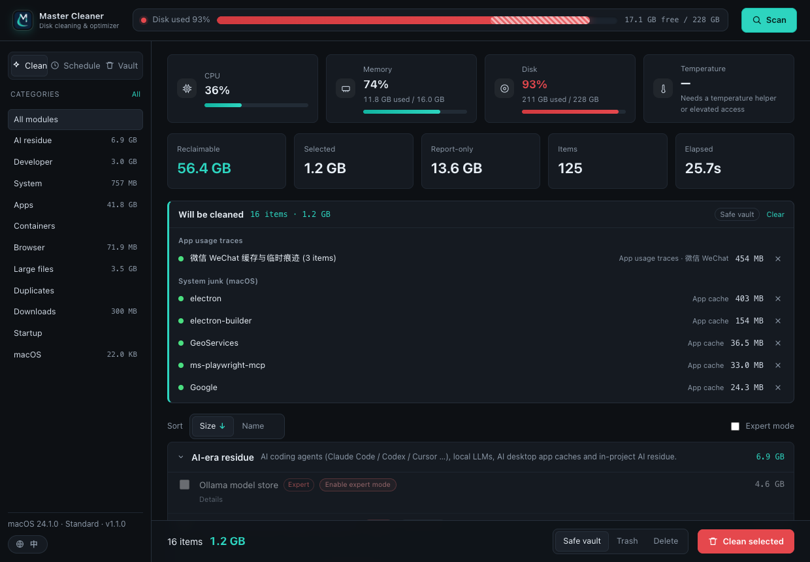
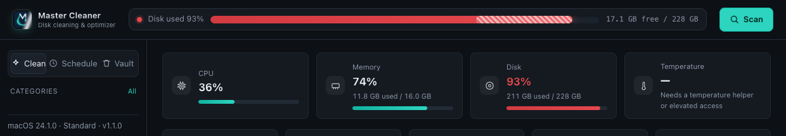
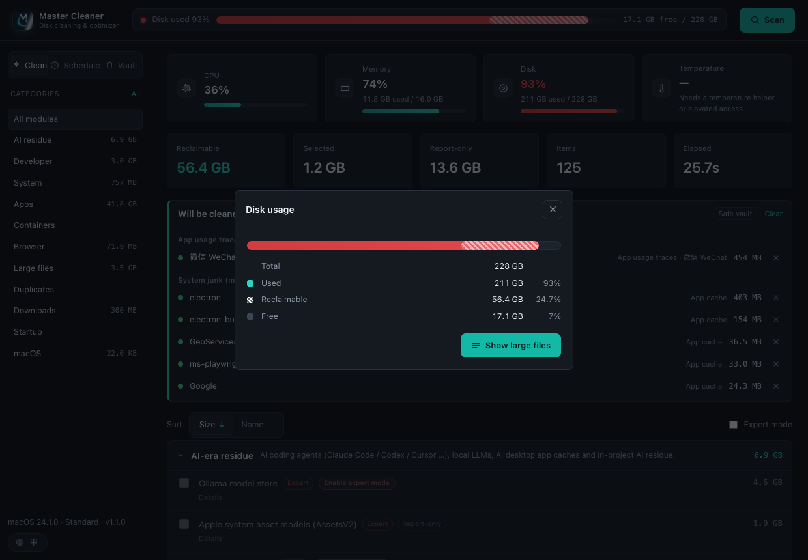
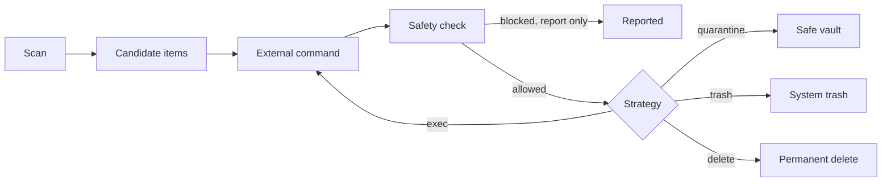
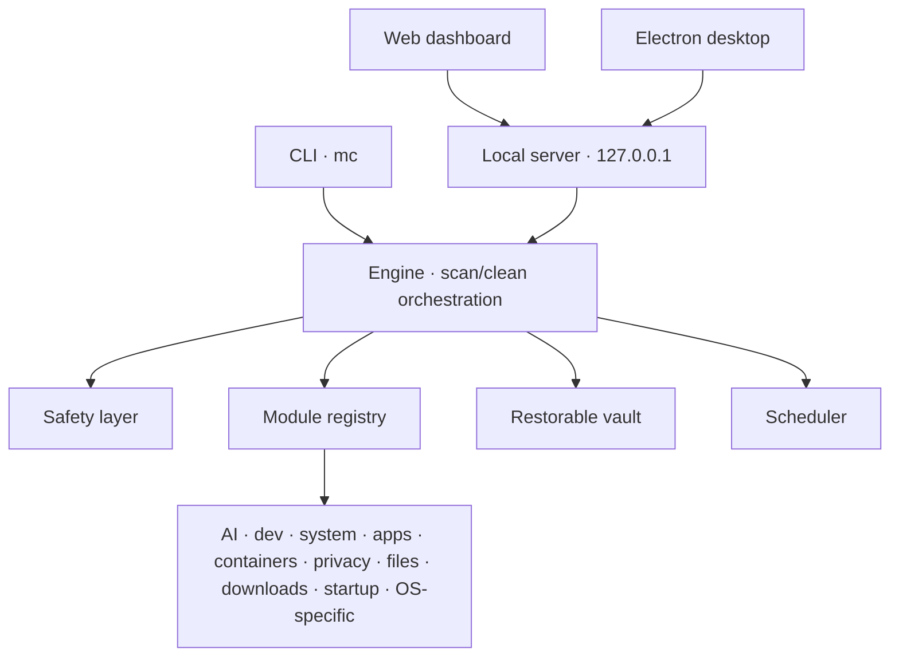

<p align="center">
  
</p>

<p align="center">
  <b>Cross-platform disk cleaner &amp; optimizer with first-class AI-era residue cleanup.</b><br>
  Reclaim caches, logs, build artifacts, container images — plus the disk footprint of AI coding agents, local models and their sessions.
</p>

<p align="center">
  
  
  
  
</p>

<p align="center">
  <a href="README.zh-CN.md">简体中文</a> · English
</p>

---

Master Cleaner is a **local-first** disk cleanup tool for developers and AI-era workflows. It ships a command-line interface (`mc`), a local web dashboard, and a desktop client — all sharing one engine. Cleaning is **restorable by default**: files are moved into a safe vault rather than deleted, and only safely rebuildable items are pre-selected.

## Screenshots

**Dashboard & scan results**

<p align="center">
  
</p>

**System monitor (the bottom-left button toggles `中` / `EN`) and disk details**

<p align="center">
  
  &nbsp;
  
</p>

## Features

- **Modular scanning** — AI residue, dev caches, system junk, app caches, app usage traces (keeps logins), containers, browser privacy, large files, duplicates, downloads, startup items, and macOS/Windows-specific residue.
- **Risk levels** — `safe` / `caution` / `expert`. Expert-level items are never pre-selected; they appear only when they can actually be cleaned.
- **Three dispositions** — safe vault (default, restorable), system trash, or permanent delete.
- **System monitor & menu bar** — live CPU / memory / disk / temperature cards; the menu-bar logo switches language on a click and starts a quick clean on a double click.
- **Scheduled cleaning** — built-in `mc daemon`, or hand off to launchd / schtasks / cron.
- **Safety layer** — independent denylist + allowlist checks; out-of-scope paths are reported, never deleted.
- **Local dashboard** — binds to `127.0.0.1` only, streams scan progress over SSE, and follows your system language on first run.
- **Modern controls** — sort results by size or name, colour-coded disk usage, reclaim preview, and hover/click details.

## Modules

| Module | Category | Risk | What it covers |
| --- | --- | --- | --- |
| `ai-residue` | AI | mixed | Claude Code / Codex / Cursor / Aider … caches, logs, sessions, local model stores, AI desktop apps |
| `dev-caches` | Developer | safe | npm/pnpm/pip/cargo/gradle caches, Xcode artifacts, project build dirs |
| `system-junk` | System | safe | OS caches, logs, crash reports, temp files (macOS/Linux/Windows variants) |
| `app-leftovers` | Apps | expert | Installed programs, uninstall info, leftover caches/preferences |
| `app-traces` | Apps | caution | Chat/social/collaboration app traces (keeps logins & chat records) |
| `containers` | Containers | expert | Docker / Podman / Colima / OrbStack / WSL images, layers, build cache, VM disks |
| `browser-privacy` | Browser | caution | Chrome/Edge/Safari/Firefox caches, history, cookies |
| `large-files` | Large files | caution | Largest individual files (videos, images, installers) |
| `duplicates` | Duplicates | caution | Byte-identical duplicate files |
| `downloads-desk` | Downloads | caution | Old large files in Downloads / Desktop |
| `startup-items` | Startup | safe | Login items, LaunchAgents, registry run keys, scheduled tasks (inventory only) |
| `macos-system` | macOS | safe | Finder leftovers, iOS backups, local snapshots, system indexes |
| `windows-system` | Windows | expert | WinSxS, Windows.old, memory dumps, hibernation/page files |

## Install

```bash
git clone https://github.com/siliang42/master-cleaner.git
cd master-cleaner
npm install
npm run build
node dist/cli.js --help
```

Requirements: **Node.js >= 18**. Runtime has no third-party npm dependencies.

Prebuilt installers are published on the [Releases](https://github.com/siliang42/master-cleaner/releases) page (macOS `.dmg`/`.zip`, Windows `Setup.exe`).

## CLI

```bash
mc scan                        # scan for reclaimable items
mc scan --json --save report.json
mc clean                       # clean the default selection (asks for confirmation)
mc clean --mode trash --yes    # move to system trash, no prompt
mc clean --dry-run             # dry run: show what would happen, change nothing
mc schedule add --name "Daily AI cleanup" --cron "0 4 * * *" --modules ai-residue,dev-caches
mc daemon                      # stay resident, clean on schedule
mc restore <record-id>         # restore from the safe vault
mc serve                       # start the local dashboard (http://127.0.0.1:43110)
mc status | doctor | modules   # overview, environment self-check, module list
mc legal                       # license, attribution and disclaimer
```

All commands accept `--lang zh-CN|en`; the language defaults to your system locale (see [Localization](#localization)).

## Desktop app

`npm run desktop` launches the Electron shell, which boots the same local server and loads the dashboard in a sandboxed window. `npm run dist:mac` / `dist:win` / `dist:linux` produce installers via electron-builder.

On macOS the app menu exposes **Preferences… (⌘,)** which opens the in-app settings (language, and future options). The `CmdOrCtrl+,` shortcut also works in the browser dashboard.

## Localization

The UI, CLI output and scanned items are fully bilingual (Simplified Chinese / English) and **follow the system language by default**. Resolution order:

1. explicit override — CLI `--lang`, env `MC_LANG`, or the in-app setting (stored in `localStorage`)
2. system locale — `Intl` / `LANG` / `LC_ALL`
3. fallback — English

Dictionaries are shared between the backend (`src/i18n.ts`) and the web UI (`web/i18n.js`) via `web/i18n/<locale>.json`.

## Safety model

Every clean action flows **module proposes candidate → engine decides → safety layer validates**:



- **Denylist** — system roots, kernel extensions, boot files and other absolute prefixes are never touched.
- **Allowlist** — a path can only be cleaned if it lives under a trusted root (home, system temp, or explicit extra roots).
- Anything failing these checks is only reported. Default cleaning moves files to a restorable vault instead of deleting.

## Privacy

Everything runs locally. Only metadata (names, sizes, times) is read; nothing is uploaded. The dashboard listens on loopback only. Scan logs may contain sensitive paths — keep your data directory and logs safe.

## Architecture

See [docs/architecture.md](docs/architecture.md) ([简体中文](docs/architecture.zh-CN.md)). At a glance:



## Disclaimer

This software **moves or deletes files** (the "permanent delete" mode is unrecoverable) and may run external cleanup commands. **Back up first, and prefer the dry-run mode.** It is provided "as is", without warranty; the authors and contributors are not liable for any data loss or other damages.

Full terms are in [DISCLAIMER.md](DISCLAIMER.md) (bilingual). Using this software means you accept them.

## License

Licensed under the [GNU Affero General Public License v3.0](LICENSE) (AGPL-3.0-only). Copyright © 2026 Johnny <obanie@qq.com> and contributors.

Under AGPLv3 Section 7, the following additional terms apply (see [NOTICE](NOTICE)):

- modified versions must preserve the attribution notice and display it in a prominent location (about page, legal page, footer, …);
- modified versions that present a user interface must keep a visible link to the original project;
- modified versions must state that they were changed and must not misrepresent their origin;
- no trademark rights are granted.

If you offer a modified version as a network service, AGPLv3 Section 13 requires you to offer the corresponding complete source code to your users.

If your organization's policy disallows AGPLv3 software, or you wish to avoid AGPLv3 obligations, contact <obanie@qq.com> to discuss alternative licensing.

The attribution notice that must be preserved:

> Designed and developed by the Master Cleaner authors and contributors.
> Copyright (C) 2026 Johnny <obanie@qq.com>.

## Third-party components

See [THIRD-PARTY-LICENSES.md](THIRD-PARTY-LICENSES.md).

## Contributing & Security

Contributions are welcome — please read [CONTRIBUTING.md](CONTRIBUTING.md). Report vulnerabilities per [SECURITY.md](SECURITY.md).

## Citation

If you use Master Cleaner in academic or derivative work, please cite it — see [CITATION.cff](CITATION.cff). The AGPLv3 Section 7 terms above apply.
