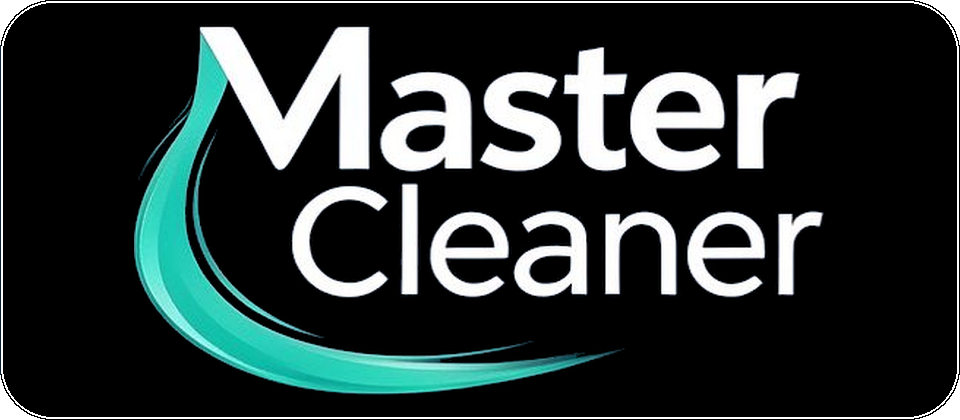
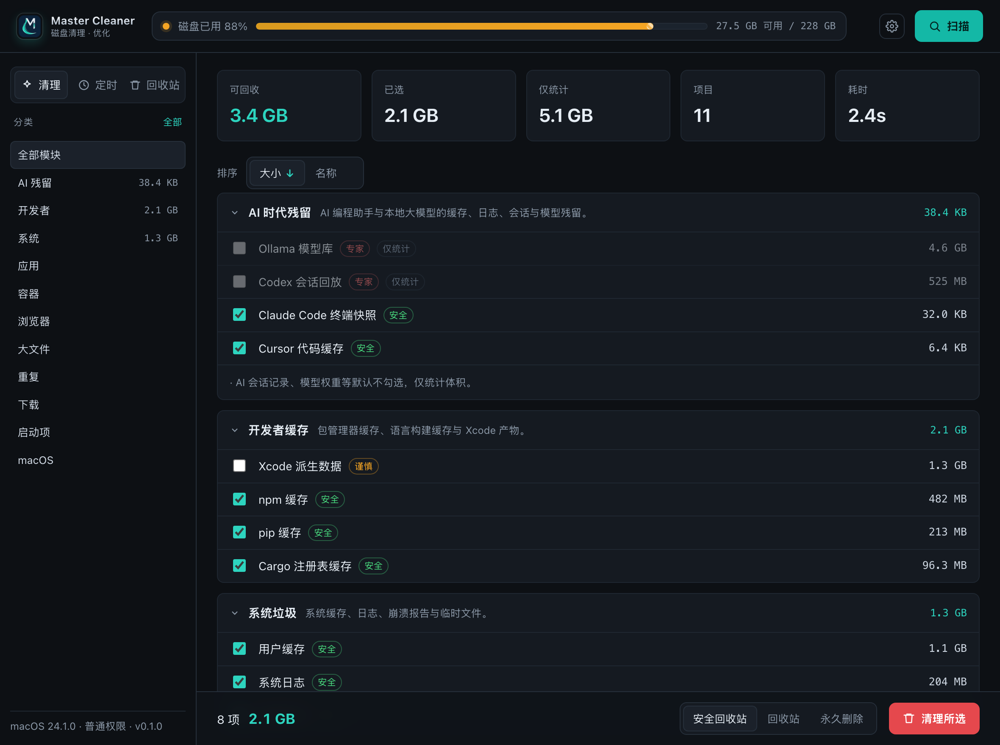
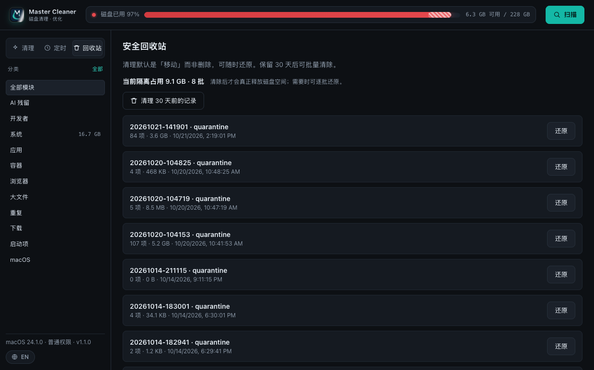
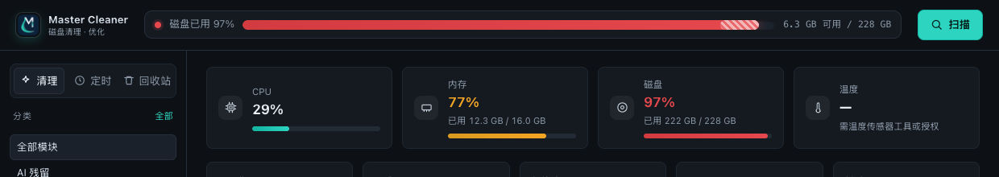
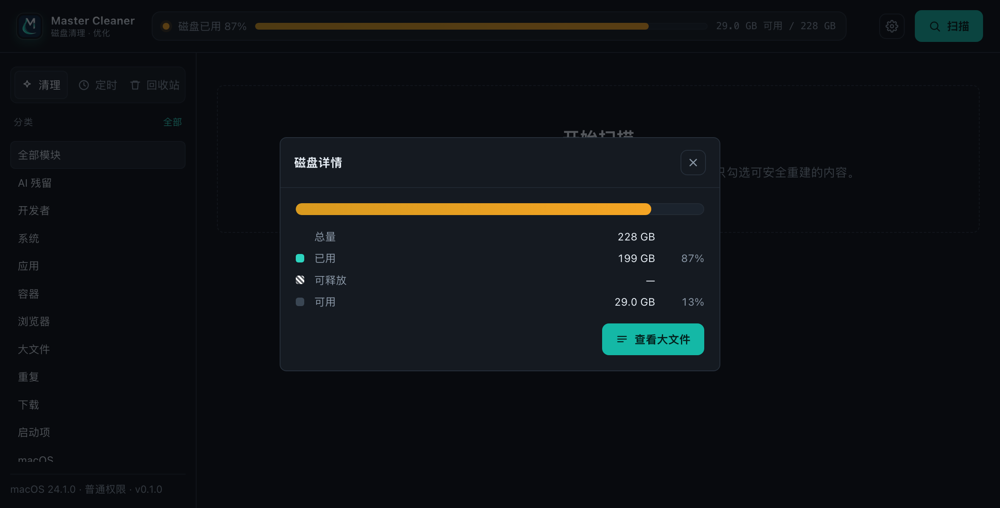
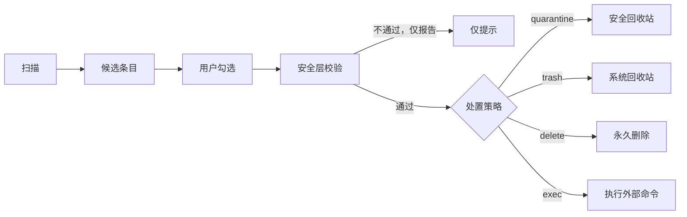
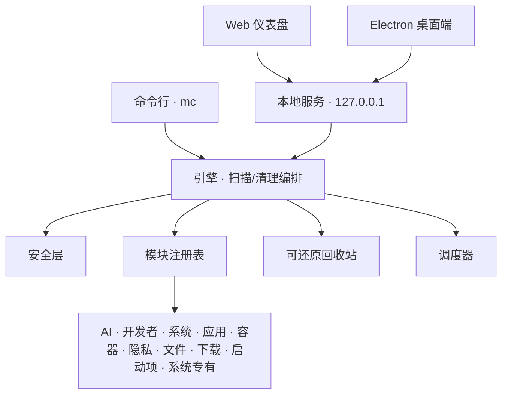

<p align="center">
  
</p>

<p align="center">
  <b>跨平台磁盘清理与优化工具，原生面向 AI 时代的工作流。</b><br>
  清理缓存、日志、构建产物、容器镜像，以及各类 AI 编码代理、本地模型与其会话留下的磁盘占用。
</p>

<p align="center">
  
  
  
  
</p>

<p align="center">
  简体中文 · <a href="README.md">English</a>
</p>

---

Master Cleaner 是一款**本地优先**的磁盘清理工具，面向开发者与 AI 时代的工作流。它同时提供命令行（`mc`）、本地 Web 仪表盘与桌面客户端，共用同一套扫描引擎。清理**默认可还原**：文件被移入安全回收站而非删除，且默认只勾选可安全重建的内容。

## 界面

**仪表盘与扫描结果**

<p align="center">
  
</p>

**安全回收站：隔离内容的真实磁盘占用，可按批次还原**

<p align="center">
  
</p>

**系统监控（左下角按钮在「中 / EN」之间互切）与磁盘详情**

<p align="center">
  
  &nbsp;
  
</p>

## 特性

- **模块化扫描**：AI 残留、开发缓存、项目工作残留（agent 产物、日志、备份、交换/合并残片）、系统垃圾、macOS 隐藏空间（签名克隆、更新器残留、共享粘贴板归档）、应用缓存、应用使用痕迹（保留登录）、容器、浏览器隐私、大文件、重复文件、下载目录、启动项，以及 macOS / Windows 专有项。
- **诚实的空间计量**：回收站页直接显示隔离内容的真实磁盘占用，并明确标注 APFS 写时复制对「可释放」数字的影响，不夸大清理效果。
- **风险分级**：`safe` / `caution` / `expert`。专家级项目默认不勾选，且仅在确实可清理时才出现。
- **三种处置方式**：安全回收站（默认，可还原）、系统回收站、永久删除。
- **系统监控与菜单栏**：CPU / 内存 / 磁盘 / 温度实时卡片；菜单栏图标单击切换语言、双击快速清理。
- **定时清理**：内置 `mc daemon`，或交给系统计划任务（launchd / schtasks / cron）。
- **安全层**：禁止清单 + 允许清单双重校验，越界路径只报告、不删除。
- **本地仪表盘**：仅绑定 `127.0.0.1`，通过 SSE 实时推送扫描进度，首次运行跟随系统语言。
- **现代交互**：结果可按大小/名称排序，磁盘占用条按占用率变色、含可释放预览，悬停/点击查看详情。

## 模块

| 模块 | 分类 | 风险 | 覆盖范围 |
| --- | --- | --- | --- |
| `ai-residue` | AI | 混合 | Claude Code / Codex / Cursor / Aider 等缓存、日志、会话，本地模型库，AI 桌面应用 |
| `dev-caches` | 开发者 | safe | npm/pnpm/pip/cargo/gradle 缓存、Xcode 产物、项目构建目录 |
| `project-residue` | 开发者 | safe | 项目里的非源码残留：编辑器/合并残片、备份、日志、崩溃转储、agent 工具缓存、Playwright 会话输出 |
| `system-junk` | 系统 | safe | 系统缓存、日志、崩溃报告、临时文件（macOS/Linux/Windows 变体） |
| `hidden-space` | 系统 | safe | macOS 隐藏空间：代码签名克隆、更新器残留、共享粘贴板归档、编译缓存、失效更新包 |
| `app-leftovers` | 应用 | expert | 已安装程序、卸载信息、残留缓存与偏好设置 |
| `app-traces` | 应用 | caution | 聊天/社交/协作应用的使用痕迹（保留登录与聊天记录） |
| `containers` | 容器 | expert | Docker / Podman / Colima / OrbStack / WSL 的镜像、层、构建缓存、虚拟机磁盘 |
| `browser-privacy` | 浏览器 | caution | Chrome/Edge/Safari/Firefox 缓存、历史、Cookie |
| `large-files` | 大文件 | caution | 占用最多的单个文件（视频、镜像、安装包） |
| `duplicates` | 重复 | caution | 按内容比对的字节级重复文件 |
| `downloads-desk` | 下载 | caution | 下载/桌面中久未清理的大文件 |
| `startup-items` | 启动项 | safe | 登录项、LaunchAgents、注册表启动项、计划任务（仅盘点） |
| `macos-system` | macOS | safe | Finder 残留、iOS 备份、本地快照、系统索引 |
| `windows-system` | Windows | expert | WinSxS、Windows.old、内存转储、休眠/页面文件 |

## 安装

```bash
git clone https://github.com/siliang42/master-cleaner.git
cd master-cleaner
npm install
npm run build
node dist/cli.js --help
```

要求：**Node.js >= 18**。运行时无第三方 npm 依赖。

预编译安装包发布在 [Releases](https://github.com/siliang42/master-cleaner/releases) 页面（macOS `.dmg`/`.zip`、Windows `Setup.exe`）。

macOS 安装包按 `arm64` 与 `x64` 分架构发布，不再把两套 Electron 框架塞进一个 universal 包；桌面运行时只保留简体中文和英文资源，并启用最高压缩级别。每个下载包与安装后的磁盘占用都会明显减小，清理引擎和功能保持一致。

## 命令行

```bash
mc scan                        # 扫描可清理项
mc scan --json --save report.json
mc clean                       # 清理默认勾选项（会确认）
mc clean --mode trash --yes    # 移入系统回收站，不询问
mc clean --dry-run             # 演练：只展示，不改动
mc schedule add --name 每日AI清理 --cron "0 4 * * *" --modules ai-residue,dev-caches
mc daemon                      # 常驻，按计划自动清理
mc restore <记录ID>            # 从安全回收站还原
mc serve                       # 启动本地仪表盘 (http://127.0.0.1:43110)
mc status | doctor | modules   # 概览、环境自检、模块列表
mc legal                       # 查看许可、署名与免责声明
```

所有命令支持 `--lang zh-CN|en`；默认跟随系统语言（见下文「多语言」）。

## 桌面客户端

`npm run desktop` 启动 Electron 外壳：主进程拉起同一个本地服务，并在沙箱窗口中加载仪表盘。`npm run dist:mac` / `dist:win` / `dist:linux` 通过 electron-builder 生成安装包。`npm run pack:mac` 只生成当前 Apple Silicon Mac 使用的未压缩应用目录。

macOS 上应用菜单提供 **偏好设置…（⌘,）**，打开应用内设置（语言，以及后续选项）。浏览器版同样支持 `Cmd/Ctrl + ,` 打开设置。

macOS 菜单栏图标单击即可展开主界面；右键（或 Control+单击）弹出快捷菜单：立即扫描、快速清理、实时磁盘余量、切换语言与退出。

Mac 上可用 `npm run install:mac` 一键打包、ad-hoc 签名、安装到 `/Applications`，并删除构建目录里的副本（详见下文）。

## macOS 签名与目录权限

从当前构建流程起，`npm run dist:mac` 产出的每个 macOS 包都会在打包完成后自动做一次 **ad-hoc 签名**（由 `scripts/adhoc-sign.js` 挂到 electron-builder 的 `afterPack` 钩子上）。这是过渡方案，不能替代 Developer ID 正式签名：

- **为什么需要** —— macOS 的文件访问授权（TCC）按应用的代码签名保存。早期构建完全没有 bundle 签名（`Identifier=Electron`、`Info.plist=not bound`），系统无法持久保存「允许」，于是每次扫描都会重新询问 Documents/Desktop/Downloads 等目录。
- **解决了什么** —— 签名后的应用会绑定 `Info.plist`、拥有稳定的应用身份（`cc.ebonex.master-cleaner`），同一份构建授权一次后不再反复弹窗。新构建的第一次扫描仍会为每个受保护目录各弹一次——这是 macOS 的正常行为，一个目录一次。
- **没解决什么** —— ad-hoc 签名的 designated requirement 是本构建的 CDHash，因此**每次安装新构建都需要重新授权一次**，无法像 Developer ID 签名那样跨构建继承授权。ad-hoc 包也无法通过 Gatekeeper 校验，从 Releases 下载的 `.dmg` 仍需右键「打开」（或系统设置 → 隐私与安全性 → 「仍要打开」）。

macOS 使用建议：

1. 用 `npm run install:mac` 安装：它会自动打包、签名、替换 `/Applications/Master Cleaner.app`，并删除构建目录里的副本，保证系统里只有一份可运行的应用。
2. 始终启动 `/Applications` 里的那一份。不要直接运行 `release/`、挂载的 `.dmg` 或解压目录中的副本——不同位置会被系统当作不同应用，各自重新弹授权。
3. 每个构建把各目录弹窗授权一次（Documents、Desktop、Downloads、Movies、Pictures）；可随时在 系统设置 → 隐私与安全性 → 文件与文件夹 中查看或撤销。
4. 未来接入 Developer ID 签名与公证后，设置 `MC_SKIP_ADHOC_SIGN=1` 跳过这一步。

### 打不开从 Releases 下载的包？（Gatekeeper）

从 GitHub 下载的 `.dmg` 会被 macOS 打上 `com.apple.quarantine` 扩展属性。由于本项目目前只提供 ad-hoc 签名，Gatekeeper 会阻止首次启动（提示「无法验证开发者」或「Apple 无法检查其是否包含恶意软件」）。二选一：

- 在 `/Applications/Master Cleaner.app` 上**右键 → 打开**，再确认「打开」；或到**系统设置 → 隐私与安全性 → 仍要打开**。
- 或用命令显式清除下载标记：

```bash
xattr -dr com.apple.quarantine "/Applications/Master Cleaner.app"
```

**原因：** `com.apple.quarantine` 是 macOS 给来自网络的下载文件打的标记，只有该标记存在时 Gatekeeper 才会执行公证校验。删除标记相当于告诉系统「这份应用已在本地受信任」，启动便不再被拦截。签名本身不会被修改——应用依然没有经过公证，也不代表适合对外分发。

**只对这一个应用执行。** `xattr -dr com.apple.quarantine /Applications/` 会清掉机器上所有应用的隔离标记，等于长期关闭 Gatekeeper 的一道系统防线。清除标记同时也是信任决定：只对本项目官方 Releases 下载的包这样做。

用 `npm run install:mac` 安装的本地构建是从 `release/` 复制过来的、不是下载的，不会带 quarantine 标记，也不需要这一步；之后如果重新从 `.dmg`/`.zip` 下载或复制应用，标记会重新出现。

## 多语言

界面、CLI 输出与扫描条目均支持中英双语，**默认跟随系统语言**。解析顺序：

1. 显式覆盖——CLI `--lang`、环境变量 `MC_LANG`，或应用内设置（存于 `localStorage`）；
2. 系统区域——`Intl` / `LANG` / `LC_ALL`；
3. 兜底——英文。

词典在后端（`src/i18n.ts`）与前端（`web/i18n.js`）之间共享，存放于 `web/i18n/<locale>.json`。

## 安全模型

每次清理都走「模块提出候选 → 引擎决策 → 安全层校验」的链路：



- **禁止清单**：系统根、内核扩展、引导文件等绝对前缀永不删除；
- **允许清单**：仅当路径位于受信根（用户主目录、系统临时目录或显式加入的根）之内才可清理；
- 不满足条件的路径一律只报告、不执行。默认清理为「移入可还原仓库」而非永久删除。

## 隐私与数据本地性

本工具在本地运行，仅读取文件名、大小、时间等元数据，不向作者或任何第三方上传数据。仪表盘默认仅监听本地回环地址。扫描与日志可能记录含敏感信息的路径，请妥善保管数据目录与日志文件。

## 架构

见 [docs/architecture.zh-CN.md](docs/architecture.zh-CN.md)（[English](docs/architecture.md)）。总览：



## 免责声明

本软件会移动或删除文件（其中「永久删除」不可恢复），并可能执行外部清理命令。**请务必在清理前自行备份，并优先使用演练模式核对。** 软件按「现状」提供，不附带任何担保；作者与贡献者不对任何数据丢失或其它损害承担责任。

完整条款见 [DISCLAIMER.md](./DISCLAIMER.md)（中英双语）。使用本软件即表示你已阅读并接受该声明。

## 许可

本项目以 [GNU Affero General Public License v3.0](./LICENSE)（AGPL-3.0-only）授权，版权归 Johnny <obanie@qq.com> 及贡献者所有。

依据 AGPLv3 第 7 条，附加以下条款（详见 [NOTICE](./NOTICE)）：

- 修改版本必须保留作者署名信息，并在其用户界面（关于页、法务页、页脚或其它显著的署名位置）中展示；
- 呈现用户界面的修改版本必须保留指向原始项目的可见链接；
- 修改版本须标注其已被修改，不得歪曲软件来源；
- 本许可不授予任何商标使用权。

若你将修改后的版本作为网络服务对外提供，依据 AGPLv3 第 13 条，你必须向用户提供对应的完整源代码。

如果贵组织的政策不允许使用 AGPLv3 软件，或你希望规避 AGPLv3 的开源义务，请联系 <obanie@qq.com> 洽谈其它许可方式。

署名要求保留的声明为：

> Designed and developed by the Master Cleaner authors and contributors.
> Copyright (C) 2026 Johnny <obanie@qq.com>.

## 第三方组件

运行时依赖与开源许可清单见 [THIRD-PARTY-LICENSES.md](./THIRD-PARTY-LICENSES.md)。

## 贡献

欢迎贡献。请阅读 [CONTRIBUTING.md](./CONTRIBUTING.md)。安全性问题请按 [SECURITY.md](./SECURITY.md) 报告。

## 引用

若在学术或衍生作品中使用 Master Cleaner，请按 [CITATION.cff](./CITATION.cff) 引用；上述 AGPLv3 第 7 条同样适用。
