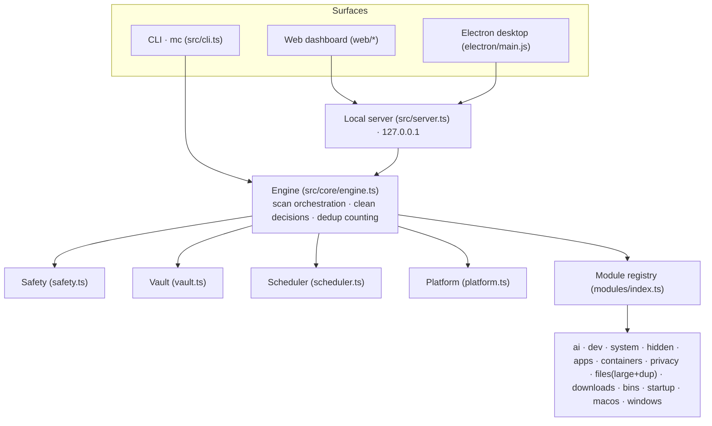

# Architecture

<a href="architecture.zh-CN.md">简体中文</a> · English

Master Cleaner separates *proposing* cleanup candidates from *deciding* and *validating* them, so no module can ever delete anything on its own.

Principle: **modules propose candidates → the engine decides → the safety layer backstops.** Modules never delete.

## Layers

| Layer | Files | Responsibility |
| --- | --- | --- |
| Surfaces | `src/cli.ts`, `web/*`, `src/server.ts`, `electron/main.js` | CLI, local dashboard, desktop shell |
| Engine | `src/core/engine.ts` | Module selection/execution, dedup accounting, `runScan` / `runClean` |
| Safety | `src/core/safety.ts` | denylist + allowlist verdicts |
| Vault | `src/core/vault.ts` | Restorable quarantine store |
| Scheduler | `src/core/scheduler.ts` | 5-field cron, persistence, daemon, OS task install |
| Platform | `src/core/platform.ts` | disk usage, cache roots, elevation, scan roots |
| Modules | `src/modules/*` | One file per domain; each returns candidate items |

## Key contracts (`src/core/types.ts`)

- `CandidateItem` — an addressable cleanup unit: `risk` (`safe`/`caution`/`expert`), `strategy` (`delete`/`trash`/`quarantine`/`exec`/`info`), `defaultSelected`, `bytes`, `paths`, optional `duplicate`.
- `CleanerModule` — `{ id, title, category, risk, platforms, defaultEnabled, scan(ctx) }`.
- `ScanReport` — aggregate with `reclaimableBytes` / `reportOnlyBytes` / `duplicateBytes` / `selectedBytes`.

## Engine (`src/core/engine.ts`)

- `runScan` filters modules by platform and enablement; with no explicit `--modules`, only `defaultEnabled` modules run (heavy modules like `duplicates` must be opted in).
- **Dedup accounting** — bytes already covered by a broader item (e.g. Docker hit by both `app-leftovers` and `containers`) are marked `duplicate`, so "reclaimable" never double-counts.
- `runClean` sends each candidate path through the safety layer, then applies its strategy: `quarantine` (default), `trash`, `delete`, or `exec`.

## Safety layer (`src/core/safety.ts`)

Two independent rules:

1. **Denylist** — absolute prefixes such as `/`, `/System`, `/usr`, `C:\Windows\System32`, and top-level `Documents`/`Desktop`/`Pictures` are never removed.
2. **Allowlist** — a path is cleanable only if it lives under a trusted root: `$HOME`, the system temp dir, or explicitly added `extraRoots`.

`verdict(path)` returns `{ ok, reason }`; anything failing is pushed to `skipped` and only reported.

## Restorable vault (`src/core/vault.ts`)

The default `quarantine` strategy **moves** files into `~/.master-cleaner/vault/<runId>/files/` and writes a `vault-manifest.json` mapping `original -> stored`. Supported by `mc restore <runId>` and `mc vault purge [--older-than N]`. Cross-device moves fall back to copy + delete.

The Vault view shows the vault's real on-disk footprint, because "moved into the vault" is not the same as "space freed". `/api/state` serves a 30-second cached size (fast `du`, invalidated on save/restore/purge), so the dashboard never blocks on walking the vault.

## Hidden space (macOS)

`hidden-space` (`src/modules/hidden-space.ts`) covers the per-user volume under `/private/var/folders` that ordinary cleaners never enter:

- `X/<bundle>.code_sign_clone/…` — Gatekeeper verification copies (often GB each);
- `T/*.ShipIt.*` — staging dirs left by interrupted app updaters;
- `T/com.apple.useractivityd/…/archives` — Universal Clipboard archives;
- `C/clang`, `C/com.apple.metal` — regenerable compiler / shader caches;
- `~/Library/Application Support/<app>/update/update_downloading` — stale update packages.

Safety model: every candidate is allow-listed by name, gated by age, and grouped per app so only the newest copy is kept. A report-only overview lists the `X/C/T` totals plus the vault's own footprint, and APFS copy-on-write caveats are surfaced so shared blocks are not counted as reclaimed space.

## Scheduler (`src/core/scheduler.ts`)

- Built-in 5-field cron parser with `nextRun()`;
- schedules persisted in `~/.master-cleaner/schedules.json`;
- `mc daemon` polls in the background; `mc schedule install` writes launchd (macOS) / schtasks (Windows) / crontab (Linux) entries.

## Platform adaptation

`platform.ts` exposes `diskUsage` (`statfsSync`), `userCacheRoots`, `isElevated`, and `defaultScanRoots`. Modules declare supported platforms via `platforms`; unsupported ones return `supported: false` and are labelled in the UI (e.g. Windows-only modules on macOS).

## Performance conventions

Filesystem traversal is the dominant cost. Rules:

- bound traversal with `maxDepth` / `maxEntries`;
- `skipDirs` / `skipSuffixes` skip `node_modules`, `.git`, `Library`, caches, `.app`/`.photoslibrary` bundles, etc.;
- prefer native tools over slow walks: `du -sk`, `find -prune` for `.DS_Store`, `docker system df`;
- large-files / duplicates only scan user content dirs (Downloads, Desktop, Documents, Movies, Pictures, Music).

(Measured: a full default scan on the dev machine dropped from ~70s to ~24s.)

## Web dashboard (`web/*` + `src/server.ts`)

- binds to `127.0.0.1` only; `/api/scan/stream` streams progress over SSE;
- endpoints: `/api/state`, `/api/clean`, `/api/schedules*`, `/api/vault/*`, `/api/legal`, `/api/config`;
- the front-end is dependency-free vanilla HTML/CSS/JS, responsive down to narrow widths;
- deep link `/?auto=1` starts a scan immediately (also `&modules=` / `&sort=`).

## Internationalization

`src/i18n.ts` (backend/CLI) and `web/i18n.js` (front-end) share dictionaries in `web/i18n/<locale>.json`. The default locale follows the system (`Intl` / `LANG` / `LC_ALL`); overrides come from `MC_LANG`, CLI `--lang`, or the in-app setting. Two translation layers are used: keyed `t()` for first-party strings, and phrase/token `localize()` for module-produced text.

## Privacy & license

All processing is local; nothing is uploaded. Legal metadata has a single source in `src/core/legal.ts` (`mc legal`, the dashboard and `--version` share it). Licensed under AGPLv3 (AGPL-3.0-only).
