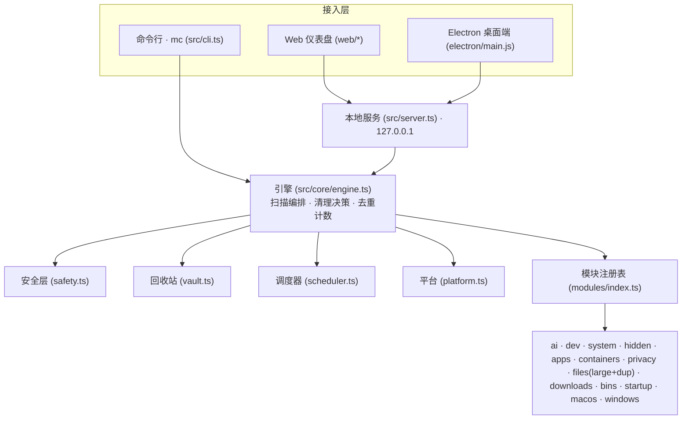

# 架构说明

<p align="center">简体中文 · <a href="architecture.md">English</a></p>

Master Cleaner 把「提出清理候选」与「决策/校验」分离，因此任何模块都无法自行删除文件。



原则：**模块只“提出候选”，引擎做决策，安全层做兜底**。模块本身不删除任何东西。

## 分层

```
CLI (src/cli.ts)          Web 仪表盘 (web/*) + 本地服务 (src/server.ts)
        \                       /
         \                     /
          引擎 engine.ts（扫描编排 / 清理决策 / 去重计数）
                 |
   +-------------+-------------------------------+
   |             |               |               |
 安全层        回收站           调度器         平台探测
 safety.ts    vault.ts      scheduler.ts    platform.ts
   |             |               |
   +-------------+---------------+---------+
                 |
            模块注册表 modules/index.ts
                 |
  ai / dev / system / hidden / apps / containers / privacy /
  files(large+dup) / downloads / bins / startup /
  macos / windows
```

原则：**模块只“提出候选”，引擎做决策，安全层做兜底**。模块本身不删除任何东西。

## 关键契约（src/core/types.ts）

- `CandidateItem`：一个可寻址的清理单元。字段含 `risk`（safe/caution/expert）、
  `strategy`（delete/trash/quarantine/exec/info）、`defaultSelected`、`bytes`、
  `paths`、`duplicate?`。
- `CleanerModule`：`{ id, title, category, risk, platforms, defaultEnabled, scan(ctx) }`。
- `ScanReport`：聚合结果，包含 `reclaimableBytes` / `reportOnlyBytes` /
  `duplicateBytes` / `selectedBytes`。

## 引擎（src/core/engine.ts）

- `runScan`：按平台与启用状态筛选模块并并发/顺序执行 `scan`；
  无显式模块选择时只跑 `defaultEnabled` 的模块（重型模块如 `duplicates` 需显式开启）。
- 去重计数：跨模块重叠的字节（例如 Docker 同时被 `app-leftovers` 与 `containers`
  命中）通过 `duplicate` 标记合并，避免“可回收”虚高。
- `runClean`：对每个候选路径先过安全层，再按策略执行
  （`quarantine` 默认、`trash` 调系统回收站、`delete` 永久删除、`exec` 执行命令）。

## 安全层（src/core/safety.ts）

两条独立规则：

1. **denylist**：`/`、`/System`、`/usr`、`C:\Windows\System32`、用户主目录顶层的
   Documents/Desktop/Pictures 等绝对前缀永不删除；
2. **allowlist**：仅当路径位于受信根（`$HOME`、系统临时目录、显式 `extraRoots`）
   之内才可清理。

`verdict(path)` 返回 `{ok, reason}`；不通过的路径进入 `skipped`，只报告不删除。

## 可还原回收站（src/core/vault.ts）

默认策略 `quarantine` 把文件**移动**到 `~/.master-cleaner/vault/<runId>/files/`，
并写入 `vault-manifest.json` 记录 `original -> stored` 映射。支持：
`mc restore <runId>` 还原、`mc vault purge [--older-than N]` 清理。
跨设备移动自动回退为「复制 + 删除」。

回收站页显示隔离内容的**真实磁盘占用**，因为「移进回收站」不等于「已释放空间」。
`/api/state` 返回 30 秒缓存的体积（快速 `du`，在保存/还原/清理时失效），
首屏不必等待对整个回收站目录的遍历。

## 隐藏空间（macOS）

`hidden-space`（`src/modules/hidden-space.ts`）扫描 `/private/var/folders` 下
常规清理器不会进入的用户级卷：

- `X/<bundle>.code_sign_clone/…`：Gatekeeper 校验产生的应用副本（单份常达 GB）；
- `T/*.ShipIt.*`：应用更新器中断后留下的暂存目录；
- `T/com.apple.useractivityd/…/archives`：共享粘贴板归档；
- `C/clang`、`C/com.apple.metal`：可再生的编译/着色器缓存；
- `~/Library/Application Support/<app>/update/update_downloading`：失效更新包。

安全模型：候选一律按名称白名单 + 年龄门槛筛选，并按应用分组，只保留最新一份。
报告项汇总 `X/C/T` 总量与回收站自身占用，同时标注 APFS 写时复制影响，
避免把共享块算作已释放空间。

## 调度（src/core/scheduler.ts）

- 自带 5 段 cron 解析与 `nextRun()`；
- 计划持久化在 `~/.master-cleaner/schedules.json`；
- `mc daemon` 常驻轮询；`mc schedule install` 生成
  launchd（macOS）/ schtasks（Windows）/ crontab（Linux）配置。

## 平台适配

`platform.ts` 提供 `diskUsage`（`statfsSync`）、`userCacheRoots`、`isElevated`、
`defaultScanRoots`。扫描模块按 `platforms` 声明各自支持范围；不支持的平台返回
`supported:false` 并在 UI 中标注（例如 Windows 专有模块在 macOS 上显示为不支持）。

## 性能约定

真实磁盘遍历是最大成本，规则：

- 目录遍历设 `maxDepth` 与 `maxEntries` 上限；
- `skipDirs` / `skipSuffixes` 跳过 `node_modules`、`.git`、`Library`、各类缓存、
  `.app`/`.photoslibrary` 等包；
- 用原生命令替代慢遍历：`du -sk` 批量取体积、`find -prune` 找 `.DS_Store`、
  `docker system df` 取容器占用；
- 大文件/重复文件只扫用户内容目录（下载/桌面/文稿/影片/图片/音乐），不全盘遍历。

（实测：本机全量默认扫描从最初的 ~70s 优化到 ~24s。）

## Web 仪表盘（web/* + src/server.ts）

- 仅绑定 `127.0.0.1`；`/api/scan/stream` 用 SSE 实时推送扫描进度；
- `/api/state`、`/api/clean`、`/api/schedules*`、`/api/vault/*` 提供数据与操作；
- 前端为无依赖 vanilla HTML/CSS/JS，响应式适配桌面与窄屏；
- 深链 `/?auto=1` 打开即扫描。

## 隐私与许可

数据全部本地处理，不上传；许可与署名单一来源在 `src/core/legal.ts`
（`mc legal`、仪表盘、`--version` 共用），协议为 AGPLv3。
